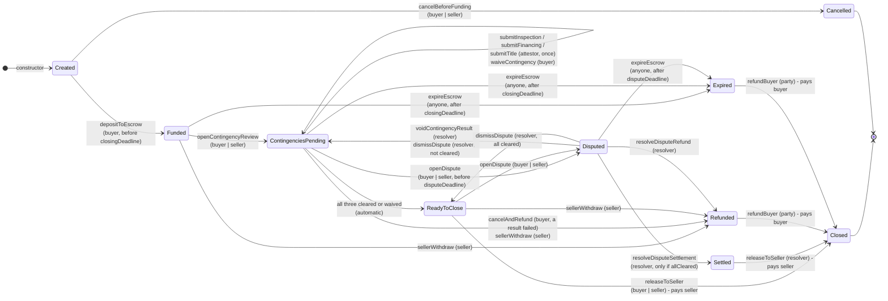

1. Check the contract conditional-real-estate-escrow-contingency-settlement.compact,
2. The contract should operate as a state machine that transitions through strict phases
3. Identify and fix potential flaws. How to prevent a resolver to overwrite a contingency result while review is pending, including changing a failed result to a passing one
4. Sugesst potential improvement as for instance
   4.1 Authorize correction paths ? When , what and who ?
   4.2 What if refundBuyer failed due to unsufficient escrow balance? do we need a arbiter role or who can handle this exceptional case ?
   4.3 What happen if buyer or seller back out
   4.4 How and where the documents should be stored

5. Document clearly each circuit and explain its use case
6. Finally draw a graph of the state machine that transitions through strict phases of this smart contact
7. Display the graph in this markdown

---

# Review report — `conditional-real-estate-escrow-contingency-settlement.compact`

*Reviewed 2026-10-22. The fixed contract compiles with `compactc` 0.31.1 (language 0.23, the version pinned by this project) and 0.35.0. A JS simulator run with `compact-runtime` 0.16.0 passed 55 of 55 scenario checks. The two most serious flaws below were reproduced on the original contract before fixing.*

## 1. Check of the original contract

The skeleton was sound: custody is atomic (`receiveUnshielded`/`sendUnshielded`), roles are hashed secrets, not `ownPublicKey()`, each attestor can submit only once, and a `disbursed` flag guards every payout. But the phases were **not strict**. Several transitions could be skipped or triggered by the wrong party.

## 2. Strict-phase rules applied

- Every exported circuit first asserts the exact source phase(s) it may run from. No circuit is valid in "any" state.
- Each transition has exactly one authorized role, or is an explicitly permissionless keeper call that is time-gated.
- `Closed` and `Cancelled` are terminal. No circuit accepts them as a source.
- Only `releaseToSeller` and `refundBuyer` move funds, and only from the approval states (`ReadyToClose`/`Settled` → seller, `Refunded`/`Expired` → buyer).
- `lifecycleRound` is incremented on **every** status change, including the automatic move to `ReadyToClose`, so off-chain clients can detect any transition.

## 3. Flaws found and fixed

| # | Severity | Flaw (original) | Fix |
|---|---|---|---|
| F1 | **Critical** | `expireEscrow` had no deadline check and no caller check (the time check was a TODO). **Anyone** could move a funded escrow to `Expired` at once and kill the deal. *Reproduced.* | `assert(blockTimeGte(closingDeadline))`. It stays permissionless (keeper call) but is time-gated. |
| F2 | **Critical** | **Resolver overwrite of a contingency result.** The seller opens a dispute after a *failed* inspection, then `resolveDisputeSettlement` → `Settled` → seller is paid. The resolver turned a failed result into a pass, and could also bypass contingencies that were still pending. *Reproduced.* | `resolveDisputeSettlement` now requires `allCleared()`. The resolver can never write a contingency value. Its only correction power is `voidContingencyResult`, which erases an attested result so the **original attestor** re-attests (see 4.1). |
| F3 | High | A `Disputed` escrow with an absent resolver locked the funds forever. | New `disputeDeadline` (constructor, must be later than `closingDeadline`). After it, `expireEscrow` also works from `Disputed` and defaults to a refund. |
| F4 | High | The seller could be named as inspector, lender or title agent and pass their own contingencies. | Constructor asserts that all attestors ≠ seller, and also buyer ≠ seller, buyer/seller ≠ resolver, `amount > 0`, `disputeDeadline > closingDeadline`. |
| F5 | Medium | The buyer could fund after `closingDeadline`, which leads to an immediate expiry and a wasted round trip. | `depositToEscrow` asserts `blockTimeLt(closingDeadline)`. |
| F6 | Medium | `openDispute` had no time limit. A party could dispute at the last moment to stall. | Disputes must be opened before `disputeDeadline`. |
| F7 | Low | `refundBuyer` was callable by anyone. Funds still went to `buyerAddress`, but any third party could trigger it. | Limited to buyer, seller or resolver (`onlyParty`). |
| F8 | Low | There was no exit before funding. The contract sat in `Created` forever. | `cancelBeforeFunding` → `Cancelled` (terminal, no funds involved). |
| F9 | Low | The automatic move to `ReadyToClose` did not bump `lifecycleRound`. | Fixed inside `advanceIfAllCleared`. |

### How the resolver is prevented from overwriting a result (item 3)

1. **No write access.** No resolver circuit assigns `*Passed`, `*Approved` or `*Cleared`. Only `submitInspection`, `submitFinancing` and `submitTitle` (each restricted to its attestor) and `waiveContingency` (buyer) write results.
2. **Write-once.** `assert(!xxxSubmitted)` blocks every in-place overwrite, including by the attestor itself.
3. **Frozen during a dispute.** Attestors can submit only in `ContingenciesPending`, so nothing changes while `Disputed`.
4. **No payout bypass.** The resolver can award the seller only when the on-chain record is already fully cleared. A failed or pending result can never become a seller payout through the resolver.
5. **Fail → pass is possible in only two ways:** the buyer, who is the protected party, waives the contingency; or the resolver voids the result and the *original* attestor re-attests it as passed.

## 4. Improvements

### 4.1 Correction paths: when, what and who

| Path | Who | When (phase) | What it can do | What it cannot do |
|---|---|---|---|---|
| Waiver (`waiveContingency`) — **implemented** | Buyer only (contingencies protect the buyer) | `ContingenciesPending` | Mark a pending **or failed** contingency as satisfied (`waived = true`, irreversible) | Make anything stricter; the seller cannot waive |
| Void and re-attest (`voidContingencyResult`) — **implemented** | Resolver, then the original attestor | Only in `Disputed` | Erase one *attested* result → back to `ContingenciesPending` → the attestor re-submits. `correctionCount` keeps the audit trail | Choose the value; void a buyer waiver; act outside a dispute |
| Dismiss (`dismissDispute`) — **implemented** | Resolver | `Disputed` | Return to `ReadyToClose` or `ContingenciesPending`, based on the record | Change any result |
| *Suggested:* attestor self-correction with a cool-down | Attestor + buyer consent | `ContingenciesPending` | Fix a clerical error | — needs two-step consent (`proposeCorrection` / `acceptCorrection`) |
| *Suggested:* cap on corrections | — | — | `assert(correctionCount < N)` to stop endless void loops (already bounded in time by `disputeDeadline`) | — |

### 4.2 `refundBuyer` with an insufficient escrow balance

- **Why it should not happen:** the contract receives exactly `escrowAmount`, and only `releaseToSeller`/`refundBuyer` can spend it, once (`disbursed`). The balance can only fall short if a future circuit spends funds, or the token or ledger behaves unexpectedly.
- **What happens if it does:** the `unshieldedBalanceGte` assert reverts the **whole transaction**. State stays `Refunded`/`Expired`, nothing is lost, and the call can be retried. Funds are not "half-sent".
- **Who handles it:** a new arbiter role is not needed; the **resolver** is the exceptional-case authority. Suggested additions:
  - `topUpEscrow(amount)`: any party (seller, resolver or insurer) deposits the shortfall. Allow it only when `!disbursed` and `unshieldedBalanceLt(color, escrowAmount)`.
  - `refundAvailable()`: resolver only, after a grace period. Sends whatever balance exists and records the shortfall on the ledger for off-chain recovery. Use it as a last resort, because it breaks the "all or nothing" invariant.
  - Keep the resolver separate from all attestors and both principals, as the constructor already enforces.

### 4.3 Buyer or seller backs out

| Who / when | Behaviour (fixed contract) | Suggested next step |
|---|---|---|
| Either side, before funding | `cancelBeforeFunding` → `Cancelled` | — |
| Seller, after funding | `sellerWithdraw` → `Refunded` → buyer is refunded | Add a seller penalty or deposit so withdrawal is not free |
| Buyer, after a failed contingency | `cancelAndRefund` → `Refunded` | — |
| Buyer, no failed contingency | No unilateral exit. They can `openDispute`; the resolver can refund, but can award the seller only if everything is cleared. Otherwise the deal expires → refund | **Earnest-money / liquidated-damages split:** add `forfeitAmount` and a `Forfeited` state that sends `forfeitAmount` to the seller and the rest to the buyer |
| Either side goes silent | `expireEscrow` after `closingDeadline` (or `disputeDeadline` when disputed) → refund | — |
| Buyer silent in `ReadyToClose` | The seller can call `releaseToSeller` | Optional dispute window: allow release only after `readySince + N` so the buyer can raise final walk-through issues |

### 4.4 Document storage

- **Never on-chain in clear text.** The ledger is public. Store only a **commitment**: `persistentHash(documentBytes ‖ salt)`.
- **Where:** encrypted off-chain storage, either IPFS/Arweave for permanence or the title company's or escrow agent's document management system. Encrypt with a per-deal key shared only with the roles involved.
- **On-chain anchor (suggested):** extend each submit circuit with `reportHash: Bytes<32>` and store `inspectionReport`, `financingLetter` and `titleCommitment`. Anyone holding the document can prove it matches. `voidContingencyResult` should keep the old hash in a history map for audit.
- **Selective disclosure:** use witnesses so an attestor can prove "report hash H says *passed*" without revealing the report.
- **Retention:** follow the jurisdiction's escrow and record-keeping rules. Deleting the off-chain copy leaves the commitment unverifiable, but nothing sensitive is left on-chain.

## 5. Circuit reference

### Helpers (not exported)

| Circuit | Purpose |
|---|---|
| `roleIdOf(sk)` *(exported, pure)* | `persistentHash("re-escrow:role:", sk)`. Clients use it to derive the role ids passed to the constructor. |
| `roleId()` | The caller's role id from the `localSecretKey` witness (the secret never leaves the prover). |
| `onlyBuyer` / `onlySeller` / `onlyBuyerOrSeller` / `onlyParty` / `onlyDisputeResolver` / `onlyInspector` / `onlyLender` / `onlyTitleAgent` | Role guards. Only the boolean match is disclosed, never the key. |
| `allCleared()` | All three contingencies are submitted and favourable (or waived). |
| `anyFailed()` | At least one submitted contingency is unfavourable. |
| `advanceIfAllCleared()` | Automatic `ContingenciesPending → ReadyToClose`. |

### Exported circuits

| Circuit | Caller | From → To | Use case |
|---|---|---|---|
| `constructor(...)` | Deployer | — → `Created` | Fixes the parties, payout addresses, token color, amount, `closingDeadline` and `disputeDeadline`. Enforces separation of duties. |
| `cancelBeforeFunding()` | Buyer or seller | `Created` → `Cancelled` | The deal falls through before any money is locked. |
| `depositToEscrow()` | Buyer | `Created` → `Funded` | Buyer locks exactly `escrowAmount` in the contract (before the deadline). |
| `openContingencyReview()` | Buyer or seller | `Funded` → `ContingenciesPending` | Starts the inspection, financing and title period. |
| `submitInspection(passed)` | Inspector | `ContingenciesPending` → same / `ReadyToClose` | Inspector records the outcome once. |
| `submitFinancing(approved)` | Lender | `ContingenciesPending` → same / `ReadyToClose` | Lender records the loan decision once. |
| `submitTitle(cleared)` | Title agent | `ContingenciesPending` → same / `ReadyToClose` | Title agent records the title search once. |
| `waiveContingency(which)` | Buyer | `ContingenciesPending` → same / `ReadyToClose` | Buyer accepts the property despite a pending or failed contingency (e.g. cash purchase, accepts defects). |
| `cancelAndRefund()` | Buyer | `ContingenciesPending` → `Refunded` | Buyer exits because a contingency failed. |
| `sellerWithdraw()` | Seller | `Funded` / `ContingenciesPending` / `ReadyToClose` → `Refunded` | Seller backs out; the buyer gets the money back. |
| `openDispute()` | Buyer or seller | `ContingenciesPending` / `ReadyToClose` → `Disputed` | Contest a result or the closing; freezes the escrow. |
| `resolveDisputeRefund()` | Resolver | `Disputed` → `Refunded` | Resolver rules for the buyer. |
| `resolveDisputeSettlement()` | Resolver | `Disputed` → `Settled` | Resolver rules for the seller; **only when all contingencies are cleared**. |
| `voidContingencyResult(which)` | Resolver | `Disputed` → `ContingenciesPending` | Erases one contested attestation so its original attestor re-attests. |
| `dismissDispute()` | Resolver | `Disputed` → `ReadyToClose` / `ContingenciesPending` | Dispute rejected; resume where the record says. |
| `expireEscrow()` | Anyone (keeper) | `Funded` / `ContingenciesPending` → `Expired` after `closingDeadline`; `Disputed` → `Expired` after `disputeDeadline` | Guarantees the funds are never stuck. |
| `releaseToSeller()` | Buyer/seller (from `ReadyToClose`), resolver (from `Settled`) | → `Closed` | Pays the seller the full amount; closing. |
| `refundBuyer()` | Buyer, seller or resolver | `Refunded` / `Expired` → `Closed` | Pays the buyer back the full amount. |

## 6–7. State machine

**Phases at a glance:** *Setup* (`Created`) → *Custody* (`Funded`) → *Review* (`ContingenciesPending`, with optional `Disputed`) → *Decision* (`ReadyToClose` / `Settled` / `Refunded` / `Expired`) → *Payout* (`Closed`). Funds move only on the last arrow.

## Remaining notes

- `blockTimeLt`/`blockTimeGte` use the block timestamp in seconds, so pass the deadlines as unix seconds. Validators can skew block time slightly, so leave a margin of hours, not seconds.
- `roleIdOf` uses a fixed domain tag. Reusing one secret across deals makes the deals linkable. Consider adding the contract address or a per-deal salt to the hash.
- All-or-nothing payouts: a partial split (earnest money, repair credits) needs an extra state and two `sendUnshielded` calls (see 4.3).
