# You are a midnight smart contract expert . The goal is to delay the initialisation of the contract .

# Check if the instructions below ( 1 to 7) can be implemented or it is better if you can propose a solution state of the art to delay the initialization of a midnight smart contract .

#

1. Add an admin role ( the deployer of owner of the contract)
2. The admin (owner) of the contract can be either a seller or another account
3. At the deployment time, admin, seller and buyer atributes must be populated
4. At the deployment time, the other attributes may be missing ( empty as for instance Maybe<Unit<64>>.none() or something like that )
5. Any missing contact attributes will be populated by the admin via a dApp later.
6. Track the initialiation state of the contract ( show missing and populated attributes)
7. The contract is completely initalized and usable only when all the missing attributes are populated and valid

---

# Analysis and implementation

> **Update 2026-10-23 (`kyc.md`):** the escrowed token's `escrowColor` and its `escrowTicker` are now **mandatory at deployment** and immutable. They are no longer delayed attributes. Two delayed attributes were added for KYC: `KycIssuers` (trusted CASP keys, managed with `addKycIssuer`/`removeKycIssuer`) and `KycPolicy`. The total is 11 attributes, and `configure` takes 10 `Maybe` parameters. See `kyc.md`.

*2026-10-22. Implemented in `conditional-real-estate-escrow-contingency-settlement.compact`. It compiles with `compactc` 0.31.1 and 0.35.0. A simulator run passed 78 of 78 checks (the 55 previous ones plus 23 for initialization).*

## Can points 1–7 be implemented?

Yes, all seven can be implemented in Compact. The design below follows the request, with four hardening changes listed after the table.

| # | Requirement | How it is implemented |
|---|---|---|
| 1 | Admin role | `adminId: Bytes<32>` = `roleIdOf(adminSecret)`, the same hashed-secret scheme as the other roles. Guard: `onlyAdmin()`. Not `ownPublicKey()`: a coin public key is not proof of identity inside a circuit. |
| 2 | Admin = seller or another account | Allowed: `admin == seller` or a third party (escrow agent, broker). **Rejected: `admin == buyer`.** The admin writes the payout addresses and the amount, so the buyer must not configure their own deal. |
| 3 | Admin, buyer, seller mandatory at deployment | They are plain constructor parameters. The constructor asserts `buyer != seller` and `admin != buyer`. |
| 4 | Other attributes may be missing | The other 10 constructor parameters are `Maybe<T>`: `some(v)` to set now, `none()` to leave empty. On the ledger they are kept as plain fields plus a presence set (see 6). That way the existing circuits do not have to unwrap a `Maybe` on every read, and the phase gate guarantees the values are set before they are used. |
| 5 | Admin fills missing attributes later via a dApp | One circuit, `configure(...)`, takes the same 10 `Maybe` parameters. The dApp sends `some` only for the fields being set. A single circuit means one verifier key instead of ten, which keeps deployment cost down. Values can be corrected any number of times until finalization. |
| 6 | Track initialization state | `configured: Set<InitAttribute>` (public ledger) lists the populated attributes. Missing = all `InitAttribute` members minus `configured`. `configVersion` counts admin changes, and `buyerAccepted`/`sellerAccepted` show sign-off. |
| 7 | Usable only when complete and valid | New first phase `Initializing`. Every business circuit already asserts its exact source phase, so nothing works until `finalizeInitialization()` moves the contract to `Created`. Finalize checks that all 10 attributes are present, then validates the cross-field rules: separation of duties, `disputeDeadline > closingDeadline`, and `closingDeadline` not already passed. |

## Hardening changes beyond the request

1. **Buyer and seller consent (`acceptConfiguration(expectedVersion)`).** The admin can set payout addresses, the amount and the resolver, so a configuration chosen by the admin alone is not enough to trust. Both parties must accept the complete configuration.
   - Any `configure` call resets both acceptances and bumps `configVersion`.
   - Acceptance takes the version the party read. If the admin changes something between the party reading it and accepting (front-running), the acceptance is rejected.
2. **Explicit finalize, not automatic activation.** Activation does not happen automatically when the last field is set. Cross-field rules are checked once, when every value is known, so the order in which fields are filled does not matter. The admin also gets a final review step.
3. **Admin power ends at finalization.** After `Created` the configuration is frozen and `onlyAdmin` is not used by any circuit. The admin never touches funds or contingencies.
4. **Exit during setup.** `cancelBeforeFunding` also works in `Initializing`, callable by buyer, seller or admin, and leads to `Cancelled` with no funds involved.

## Alternatives considered

- **Deploy only when every term is known.** This is the simplest and cheapest option. Delayed initialization is worth it only if the contract address is needed early: to share it, to bind documents or signatures to it, or because parties onboard at different times.
- **`Maybe<T>` ledger fields.** Workable, but every circuit would have to `assert(x.is_some)` and unwrap `x.value`. Plain fields plus `configured` keep the business circuits unchanged.
- **One setter circuit per attribute.** Gives clearer dApp calls, but adds about 10 circuits, and therefore 10 verifier keys and higher deployment cost.
- **Contract maintenance authority.** Midnight deployments can carry a maintenance authority that can change circuit verifier keys. That is an upgrade power, not configuration. For an escrow it should be empty, or held jointly, so the admin cannot alter the rules after the parties accept.

## Lifecycle of initialization

```mermaid
stateDiagram-v2
    direction LR
    [*] --> Initializing : constructor(admin, buyer, seller, Maybe terms...)
    Initializing --> Initializing : configure (admin)<br/>resets acceptances, version+1
    Initializing --> Initializing : acceptConfiguration(version)<br/>(buyer, seller; only when complete)
    Initializing --> Created : finalizeInitialization (admin)<br/>complete + valid + both accepted
    Initializing --> Cancelled : cancelBeforeFunding<br/>(admin | buyer | seller)
    Created --> Funded : depositToEscrow (buyer)
    Created --> Cancelled : cancelBeforeFunding (buyer | seller)
```

## dApp notes

- Read `ledger(state).configured.member(InitAttribute.X)` for each member to show what is populated and what is missing.
- Show the current `configVersion` and all values to buyer and seller, and pass that version to `acceptConfiguration`.
- TypeScript `Maybe` shape: `{ is_some: true, value: v }` / `{ is_some: false, value: <zero of the type> }`.
- `isFullyConfigured()` compares `configured.size()` with `11`. If you add a new `InitAttribute`, update that constant.

---

# Choosing the initialization values (2026-11-03)

Practical guidance for the attributes the admin fills in during `Initializing`, written after the Phase 2 dApp (`phase-2.md`). It applies to the **preview** network and to the eu-counterparty-simulator CASP used for tests.

## Admin sequence in the dApp

1. **Contract tab:** if circuits are missing, *Register remaining circuits*.
2. **Initialize tab:** inspector, lender, title agent and resolver role ids, the two deadlines, and the KYC policy.
3. **Terms & KYC tab:**
   - *Whitelist* the CASP issuer key (read from the CASP's `/.well-known/casp-keys`). This sets `KycIssuers`.
   - Enter the amount and the buyer's and seller's shielded payout keys (each party copies its key from its own page), *Generate package*, then *Commit to the contract*. This sets `EscrowAmount`, `BuyerPayout` and `SellerPayout` as commitments only.
   - Distribute the package (encrypted per recipient) and record at least one backup.
4. **Buyer and seller pages:** import the role key and the package, check it matches the ledger, *Accept configuration*.
5. **Terms & KYC tab:** *Finalize*. It is enabled only when all 11 attributes are set, both parties accepted the current `configVersion`, a backup exists, separation of duties holds, and the deadlines are valid.

Any change in steps 2–3 increments `configVersion` and resets both acceptances, so finish the configuration before the parties accept.

## KYC policy (`KycPolicy`)

### `minKycLevel` — recommended **2**

The level comes from the CASP's scale (eu-counterparty-simulator):

| Level | Meaning | Simulator personas |
| :--- | :--- | :--- |
| 0 | not verified | rejected by the contract (`KYC policy must require a KYC level`) |
| 1 | basic: identity only, no address proof | `buyer-basic-only` |
| **2** | **full customer due diligence (CDD)** | `buyer-clean`, `seller-clean` |
| 3 | enhanced due diligence (EDD) completed | `buyer-corporate-edd`, `buyer-pep-edd` |

Level 2 is the sensible floor for a property purchase settled in a EUR e-money token: MiCA and AMLR expect full due diligence on the counterparties, not basic identification. It also gives a clean test split: `buyer-clean` / `seller-clean` pass, `buyer-basic-only` fails with `ERROR_KYC_LEVEL_INSUFFICIENT`. Use **3** only if every party must have gone through EDD.

### `maxAmlRiskScore`

The simulator scores risk as: base 5, PEP +35, high-risk country +35, undocumented source of funds +25, high volume +10, complex ownership +10. It requires EDD from 40 and rejects at 80 (`eu-counterparty-simulator/config/policy.json`).

| Value | Effect |
| :--- | :--- |
| **30** | Accepts clean retail parties (≈5) and the corporate EDD buyer (≈25); rejects the PEP with EDD (≈40). Used by Simulator Mode. |
| 39 | Only parties that never needed EDD (just below the CASP's EDD threshold). |
| 79 | Anyone the CASP approved, including an EDD-cleared PEP; relies on the CASP's own reject threshold. |

**For preview tests: `minKycLevel = 2`, `maxAmlRiskScore = 30`.** It matches Simulator Mode and gives a pass, a level failure and a risk failure to test.

For a production deployment the policy is a decision of the obliged entity's compliance function, not a technical choice.

## Deadlines (`ClosingDeadline`, `DisputeDeadline`)

**The dispute deadline must be after the closing deadline.** `finalizeInitialization` asserts `disputeDeadline > closingDeadline` ("Dispute deadline must follow closing deadline") and `blockTimeLt(closingDeadline)` ("Closing deadline is already in the past"); the admin form checks the order before submitting. Both are unix seconds.

| Deadline | Purpose | Enforced by |
| :--- | :--- | :--- |
| `closingDeadline` | Deal funded and contingencies settled | `depositToEscrow` fails after it; `expireEscrow` is allowed after it in `Funded` / `ContingenciesPending`; must still be in the future at finalize |
| `disputeDeadline` | End of the dispute and payout window: the backstop that keeps the buyer's funds from being locked forever | `openDispute` only before it; `expireEscrow` after it in `Disputed`, or in `ReadyToClose` / `Settled` when the seller has no usable KYC |

Leave enough time between the two for a dispute opened near closing to be resolved and paid out.

| Setting | Closing | Dispute |
| :--- | :--- | :--- |
| Simulator Mode default | now + 30 days | now + 45 days (closing + 15 days) |
| Quick preview test of expiry paths | now + 2 h | now + 4 h |

**Seller KYC vs deadlines:** the simulator's attestations are valid for 7 days (`attestationValidityDays`). `releaseToSeller` needs an unexpired seller attestation, and after `disputeDeadline` an escrow in `ReadyToClose` / `Settled` whose seller KYC has expired can be expired and refunded instead of released. For long deadlines, have the seller renew (`submitSellerKyc` again) before release.

## Other attributes

- **Roles:** the resolver must differ from buyer, seller and every attestor; attestors must differ from the seller. A cash buyer may also be the lender (`lenderId == buyerId`).
- **Commitments:** never typed by hand; generated from the private terms package (fresh salts per package). Losing every copy of the package makes payout impossible, so the dApp requires a confirmed backup before finalize.
- **KycIssuers:** whitelist only CASPs independent of the seller and the resolver. Removing the last issuer during `Initializing` removes the attribute again.

---

# Maintenance authority (2026-11-06)

The deploy creates a **contract maintenance authority**: a signing key that can add, remove or replace circuit verifier keys and replace the authority itself. Whoever holds it can change the contract's rules after the parties accepted them — for example swap in a `refundBuyer` that pays another key, or remove every payout circuit. The project therefore applies the strongest option:

1. **Renounce the authority once every circuit is registered.** *Admin → Keys → Renounce authority (make immutable)* submits one maintenance transaction replacing the authority with an **empty committee, threshold 1** (no one can ever reach the threshold — it is also the ledger's own default for "no authority"). Irreversible: no verifier key can be added, removed or replaced afterwards. The button is enabled only when all 25 circuits are registered and the vault's key matches the on-chain authority; the confirmation requires typing `RENOUNCE`. On success the key is deleted from the vault.
2. **Show the authority to every party (and the notary).** The status card on every page reads the on-chain committee:
   - *Contract immutable* — committee empty (renounced);
   - *Maintenance authority active* — a key can still change the rules;
   - *Danger* — threshold 0 (anyone could change the rules).

   The pre-flight **blocks `depositToEscrow`** while the authority is active and **warns** on `acceptConfiguration`. The notary certificate records the authority level, committee size, threshold and counter.
3. **The key is stored only in the encrypted vault.** It is no longer written to plain `localStorage`:
   - the deploy requires an unlocked vault, and the key midnight-js creates is saved encrypted in the contract's vault record;
   - keys midnight-js invents when opening a contract (it does so whenever none is stored) stay in memory and are never persisted;
   - keys left in plain `localStorage` by earlier versions (`escrow:sk:<address>`, including `:replaced:` copies) are moved into the vault on the next unlock, verified, then deleted;
   - export / import on the Keys tab work through the vault; importing keeps the previous key in the record's history.

The key is never sent over the network: maintenance updates (batched circuit registration and the renounce) are signed in the browser and only the signature goes into the transaction.

**Recommended order:** deploy → register the remaining circuits (batches of 4) → test → **renounce** → configure terms → parties accept → finalize → deposit.

**To validate on preview (V-6):** that the node accepts the replacement by an empty committee with threshold 1, and that `contractState.maintenanceAuthority` then reports an empty committee.
