# You are a midnight smart contract expert . The goal is to delay the initialisation of the contract .

# Check if the instructions below ( 1 to 7) can be implemented or it is better if you can propose a solution state of the art to delay the initialization of a midnight smart contract .

#

1. Add an admin role ( the deployer of owner of the contract)
2. The admin (owner) of the contract can be either a seller or another account
3. At the deployment time, admin, seller and buyer atributes must be populated
4. At the deployment time, the other attributes may be missing ( empty as for instance Maybe<Unit<64>>.none() or something like that )
5. Any missing contact attributes will be populated by the admin via a dApp later.
6. Track the initialiation state of the contract ( show missing and populated attributes)
7. The contract is completely initalized and usable only when all the missing attributes are populated and valid

---

# Analysis and implementation

> **Update 2026-10-23 (`kyc.md`):** the escrowed token's `escrowColor` and its `escrowTicker` are now **mandatory at deployment** and immutable. They are no longer delayed attributes. Two delayed attributes were added for KYC: `KycIssuers` (trusted CASP keys, managed with `addKycIssuer`/`removeKycIssuer`) and `KycPolicy`. The total is 11 attributes, and `configure` takes 10 `Maybe` parameters. See `kyc.md`.

*2026-10-22. Implemented in `conditional-real-estate-escrow-contingency-settlement.compact`. It compiles with `compactc` 0.31.1 and 0.35.0. A simulator run passed 78 of 78 checks (the 55 previous ones plus 23 for initialization).*

## Can points 1–7 be implemented?

Yes, all seven can be implemented in Compact. The design below follows the request, with four hardening changes listed after the table.

| # | Requirement | How it is implemented |
|---|---|---|
| 1 | Admin role | `adminId: Bytes<32>` = `roleIdOf(adminSecret)`, the same hashed-secret scheme as the other roles. Guard: `onlyAdmin()`. Not `ownPublicKey()`: a coin public key is not proof of identity inside a circuit. |
| 2 | Admin = seller or another account | Allowed: `admin == seller` or a third party (escrow agent, broker). **Rejected: `admin == buyer`.** The admin writes the payout addresses and the amount, so the buyer must not configure their own deal. |
| 3 | Admin, buyer, seller mandatory at deployment | They are plain constructor parameters. The constructor asserts `buyer != seller` and `admin != buyer`. |
| 4 | Other attributes may be missing | The other 10 constructor parameters are `Maybe<T>`: `some(v)` to set now, `none()` to leave empty. On the ledger they are kept as plain fields plus a presence set (see 6). That way the existing circuits do not have to unwrap a `Maybe` on every read, and the phase gate guarantees the values are set before they are used. |
| 5 | Admin fills missing attributes later via a dApp | One circuit, `configure(...)`, takes the same 10 `Maybe` parameters. The dApp sends `some` only for the fields being set. A single circuit means one verifier key instead of ten, which keeps deployment cost down. Values can be corrected any number of times until finalization. |
| 6 | Track initialization state | `configured: Set<InitAttribute>` (public ledger) lists the populated attributes. Missing = all `InitAttribute` members minus `configured`. `configVersion` counts admin changes, and `buyerAccepted`/`sellerAccepted` show sign-off. |
| 7 | Usable only when complete and valid | New first phase `Initializing`. Every business circuit already asserts its exact source phase, so nothing works until `finalizeInitialization()` moves the contract to `Created`. Finalize checks that all 10 attributes are present, then validates the cross-field rules: separation of duties, `disputeDeadline > closingDeadline`, and `closingDeadline` not already passed. |

## Hardening changes beyond the request

1. **Buyer and seller consent (`acceptConfiguration(expectedVersion)`).** The admin can set payout addresses, the amount and the resolver, so a configuration chosen by the admin alone is not enough to trust. Both parties must accept the complete configuration.
   - Any `configure` call resets both acceptances and bumps `configVersion`.
   - Acceptance takes the version the party read. If the admin changes something between the party reading it and accepting (front-running), the acceptance is rejected.
2. **Explicit finalize, not automatic activation.** Activation does not happen automatically when the last field is set. Cross-field rules are checked once, when every value is known, so the order in which fields are filled does not matter. The admin also gets a final review step.
3. **Admin power ends at finalization.** After `Created` the configuration is frozen and `onlyAdmin` is not used by any circuit. The admin never touches funds or contingencies.
4. **Exit during setup.** `cancelBeforeFunding` also works in `Initializing`, callable by buyer, seller or admin, and leads to `Cancelled` with no funds involved.

## Alternatives considered

- **Deploy only when every term is known.** This is the simplest and cheapest option. Delayed initialization is worth it only if the contract address is needed early: to share it, to bind documents or signatures to it, or because parties onboard at different times.
- **`Maybe<T>` ledger fields.** Workable, but every circuit would have to `assert(x.is_some)` and unwrap `x.value`. Plain fields plus `configured` keep the business circuits unchanged.
- **One setter circuit per attribute.** Gives clearer dApp calls, but adds about 10 circuits, and therefore 10 verifier keys and higher deployment cost.
- **Contract maintenance authority.** Midnight deployments can carry a maintenance authority that can change circuit verifier keys. That is an upgrade power, not configuration. For an escrow it should be empty, or held jointly, so the admin cannot alter the rules after the parties accept.

## Lifecycle of initialization

```mermaid
stateDiagram-v2
    direction LR
    [*] --> Initializing : constructor(admin, buyer, seller, Maybe terms...)
    Initializing --> Initializing : configure (admin)<br/>resets acceptances, version+1
    Initializing --> Initializing : acceptConfiguration(version)<br/>(buyer, seller; only when complete)
    Initializing --> Created : finalizeInitialization (admin)<br/>complete + valid + both accepted
    Initializing --> Cancelled : cancelBeforeFunding<br/>(admin | buyer | seller)
    Created --> Funded : depositToEscrow (buyer)
    Created --> Cancelled : cancelBeforeFunding (buyer | seller)
```

## dApp notes

- Read `ledger(state).configured.member(InitAttribute.X)` for each member to show what is populated and what is missing.
- Show the current `configVersion` and all values to buyer and seller, and pass that version to `acceptConfiguration`.
- TypeScript `Maybe` shape: `{ is_some: true, value: v }` / `{ is_some: false, value: <zero of the type> }`.
- `isFullyConfigured()` compares `configured.size()` with `11`. If you add a new `InitAttribute`, update that constant.
