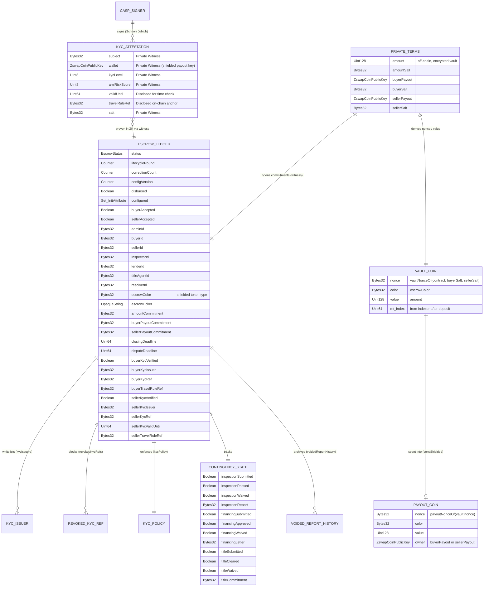

# Software & Functional Requirements Specification (SRS / FRS)
## Conditional Real-Estate Escrow & Contingency Settlement Front-End dApp

**Project Name:** `conditional-escrow-contingency-and-settlement`  
**Smart Contract:** [`contract/conditional-real-estate-escrow-contingency-settlement.compact`](contract/conditional-real-estate-escrow-contingency-settlement.compact)  
**Target Network:** Midnight Network (`preprod` / Mainnet). Compact `0.31.1` (language `>= 0.23`), `compact-runtime 0.16.0`, `midnight-js 4.1.1`, `proof-server 8.1.0`  
**Target Region:** Europe (EU/EEA). Applicable frameworks: MiCA, the EU Transfer of Funds Regulation (Travel Rule / IVMS101), AMLD6 / AMLR, GDPR, eIDAS 2.0, and civil-law notary and land registry procedures

### Document control

| Version | Date | Change |
| :--- | :--- | :--- |
| 1.0 | 2026-10-23 | Initial SRS (unshielded custody). |
| **2.0** | **2026-10-24** | **The contract moves to shielded token custody.** `escrowAmount`, `buyerAddress` and `sellerAddress` are no longer on the ledger. They are replaced by salted commitments and opened through the `privateTerms` witness. **New modules:** Private Terms Vault (FR-TERMS), Funding & Shielded Custody (FR-FUND), Compliance (FR-KYC), Dispute Resolution (FR-DISPUTE), Settlement & Payout Coin Import (FR-SETTLE), Notary Portal (FR-NOTARY) and Audit & Notifications (FR-AUDIT). **New tables:** error-code catalogue and circuit-to-requirement traceability. **Removed:** the indexer source-of-funds UTXO auditor, which is impossible with shielded inputs. See [`contract/shielded-token.md`](contract/shielded-token.md) for the contract analysis and the items to validate before front-end work starts. |

> **Status:** the specification is complete for v1.0. **Front-end development has not started.** It is gated on the validation items in §8.

---

## 1. Introduction & Purpose

### 1.1 Purpose
This SRS defines the functional, non-functional, data-model and external-interface requirements for the **Conditional Real-Estate Escrow & Contingency Settlement Front-End dApp**. The dApp is built with **React 19, Next.js 15 (App Router), TypeScript and the Midnight Network SDK**.

It provides a privacy-preserving, cryptographically verifiable web interface over the full lifecycle of [`conditional-real-estate-escrow-contingency-settlement.compact`](contract/conditional-real-estate-escrow-contingency-settlement.compact) for European residential, commercial and tokenized real-estate transactions. Settlement uses a **shielded** euro-denominated e-money token (EMT).

### 1.2 Core Problem Statement (European Market Context)
1. **The notarial bottleneck and settlement latency.** European real-estate closings rely on sequential, manual verification across civil-law notaries (*Notare* / *Notaires* / *Notarios*), mortgage lenders, cadastral and land registries (*Grundbuch* / *Cadastre* / *Kadaster* / *Registro de la Propiedad*) and technical surveyors. Buyer capital sits locked in low-transparency omnibus accounts while the parties exchange paper and PDF attestations.
2. **Conflict between MiCA/AML rules and GDPR privacy.**
   - MiCA, AMLD6 / AMLR and the Transfer of Funds Regulation require strict CDD/EDD and originator/beneficiary screening for high-value settlements in EMTs.
   - GDPR (Art. 5 and Art. 25) prohibits publishing identity documents, risk scores, property defect reports or (with shielded custody) the purchase price and the parties' wallets on a public ledger.
3. **Counterparty and custody risk.** Buyers need guarantees enforced by the contract:
   - escrowed capital is released only when every contingency (`Inspection`, `Financing`, `Title`) clears and the seller holds valid, unrevoked KYC;
   - otherwise it is refundable when a contingency fails, the seller withdraws, or a deadline passes (`closingDeadline` / `disputeDeadline`).

### 1.3 Scope
- **In scope:**
  - a web dApp (desktop and mobile web) for every on-chain role;
  - a read-only notary / land-registry portal;
  - a compliance console;
  - an in-browser simulator mode.
- **Out of scope:** see §7.3.

### 1.4 Definitions & Acronyms

| Term | Meaning |
| :--- | :--- |
| **CASP** | Crypto-asset service provider (MiCA). Here, the KYC/AML attestation issuer. |
| **EMT** | E-money token (MiCA Title IV), e.g. a euro stablecoin issued as a **shielded** Midnight token. |
| **Shielded coin** | A Zswap coin `{nonce, color, value}`. Only its commitment is on-chain; amount and owner are hidden. |
| **Vault coin** | The single shielded coin the contract owns after `depositToEscrow`. Its nonce is `vaultNonceOf(contract, buyerSalt, sellerSalt)`. |
| **Private terms** | `PrivateTerms { amount, amountSalt, buyerPayout, buyerSalt, sellerPayout, sellerSalt }`. Known to the deal parties off-chain. The ledger holds only `amountCommitment`, `buyerPayoutCommitment` and `sellerPayoutCommitment`. |
| **Opening** | The value and salt of a commitment, given to someone so they can verify it (e.g. a notary verifying the purchase price). |
| **Role secret / role ID** | 32-byte `localSecretKey` / `roleIdOf(sk)`, identifying admin, buyer, seller, inspector, lender, title agent and resolver. |
| **Payout key** | A party's shielded `ZswapCoinPublicKey`, the destination of a shielded payout. |

### 1.5 References
- [`contract/compact.md`](contract/compact.md): contract review, circuit reference and state machine
- [`contract/delay-init.md`](contract/delay-init.md): delayed initialization
- [`contract/kyc.md`](contract/kyc.md): KYC/AML, revocation, seller KYC, Travel Rule anchor
- [`contract/shielded-token.md`](contract/shielded-token.md): shielded custody design, EU recommendations, pre-front-end observations
- [`contract/test/escrow.sim.mjs`](contract/test/escrow.sim.mjs) and [`contract/test/casp-signer.mjs`](contract/test/casp-signer.mjs): simulator tests and CASP signer
- [`plan.md`](plan.md): delivery plan

---

## 2. Overall Description, Target Audience & User Personas

### 2.1 Smart Contract Architecture Summary
The contract enforces the following.

- **Shielded token custody, with private amount and payout keys:**
  - [`depositToEscrow(coin)`](contract/conditional-real-estate-escrow-contingency-settlement.compact#L684) claims exactly one shielded coin of `escrowColor` with `receiveShielded`. The coin must equal `{vaultNonceOf(contract, buyerSalt, sellerSalt), escrowColor, amount}`.
  - [`releaseToSeller`](contract/conditional-real-estate-escrow-contingency-settlement.compact#L910) and [`refundBuyer`](contract/conditional-real-estate-escrow-contingency-settlement.compact#L932) spend that coin **in full** to the committed shielded payout key with `sendShielded` ([`payOutVault`](contract/conditional-real-estate-escrow-contingency-settlement.compact#L507)). The `disbursed` guard makes this happen once.
  - The ledger stores only salted commitments ([`amountCommitmentOf`](contract/conditional-real-estate-escrow-contingency-settlement.compact#L458), [`payoutCommitmentOf`](contract/conditional-real-estate-escrow-contingency-settlement.compact#L461)). Every circuit that needs the terms opens them through the [`privateTerms`](contract/conditional-real-estate-escrow-contingency-settlement.compact#L177) witness ([`openTerms`](contract/conditional-real-estate-escrow-contingency-settlement.compact#L483)). Payouts take the vault coin and its Merkle index from the [`vaultCoin`](contract/conditional-real-estate-escrow-contingency-settlement.compact#L180) witness.
  - `escrowColor` (the shielded token type) and `escrowTicker` are immutable and set at deployment.
- **Zero-knowledge role authentication:** the witness [`localSecretKey()`](contract/conditional-real-estate-escrow-contingency-settlement.compact#L175) is hashed by [`roleIdOf(sk)`](contract/conditional-real-estate-escrow-contingency-settlement.compact#L241). Separation of duties is enforced in the [`constructor`](contract/conditional-real-estate-escrow-contingency-settlement.compact#L192) and in [`finalizeInitialization`](contract/conditional-real-estate-escrow-contingency-settlement.compact#L412).
- **11-state strict state machine ([`EscrowStatus`](contract/conditional-real-estate-escrow-contingency-settlement.compact#L35)):** `Initializing → Created → Funded → ContingenciesPending → ReadyToClose / Disputed / Settled / Refunded / Expired → Closed / Cancelled`.
- **Delayed initialization ([`InitAttribute`](contract/conditional-real-estate-escrow-contingency-settlement.compact#L51)):** 11 attributes tracked in `configured`. `BuyerPayout`, `SellerPayout` and `EscrowAmount` are now **commitments**. A version lock (`configVersion`, `buyerAccepted`, `sellerAccepted`) prevents front-running of acceptances.
- **Zero-knowledge CASP KYC/AML and Travel Rule gate:**
  - In-circuit Jubjub Schnorr verification ([`verifySchnorr`](contract/conditional-real-estate-escrow-contingency-settlement.compact#L530)) for the buyer ([`verifyBuyerKyc`](contract/conditional-real-estate-escrow-contingency-settlement.compact#L569)) and the seller ([`submitSellerKyc`](contract/conditional-real-estate-escrow-contingency-settlement.compact#L593)).
  - The attested `wallet` is the party's **shielded payout key**. It is compared privately against the committed key, so the wallet is never disclosed.
  - CASP-signed revocation can be submitted by anyone ([`revokeKycAttestation`](contract/conditional-real-estate-escrow-contingency-settlement.compact#L628), [`revokeKycIssuer`](contract/conditional-real-estate-escrow-contingency-settlement.compact#L640)).
  - Salted anchors are stored on-chain: `buyerKycRef`, `sellerKycRef`, `buyerTravelRuleRef`, `sellerTravelRuleRef`.
- **On-chain document commitments and audit trail:** contingency submissions anchor non-empty `Bytes<32>` report hashes (`inspectionReport`, `financingLetter`, `titleCommitment`). Voided hashes are archived in `voidedReportHistory`.

### 2.2 What is public and what is private (shielded custody)

| Public on the ledger | Private (never on-chain in clear) |
| :--- | :--- |
| `status`, `lifecycleRound`, deadlines, role IDs, `escrowColor`, `escrowTicker` | Purchase **amount** (only `amountCommitment`) |
| `amountCommitment`, `buyerPayoutCommitment`, `sellerPayoutCommitment` | **Buyer and seller payout keys** (only commitments) |
| Contingency booleans and document hashes | The vault coin's nonce and value, and the payout coins |
| KYC pass/fail, issuer IDs, `*KycRef`, `*TravelRuleRef`, `sellerKycValidUntil` | KYC level, AML risk score, identity documents, attested wallet |
| That a deposit and a payout happened (Zswap commitments and nullifiers) | Who funded the deposit, and where the payout went |

### 2.3 Target Audience & Persona-to-Role Mapping

| Audience Segment | User Persona | On-Chain Role / Access Mode | Core dApp Capabilities |
| :--- | :--- | :--- | :--- |
| **1. Core End Users** | **Tech-Savvy Home Buyers & Sellers** | `Buyer` (`buyerId`), `Seller` (`sellerId`), `Admin` (if Seller deploys) | Hold the deal's **private terms package**. Verify the commitments, then accept the versioned configuration (`acceptConfiguration`). Prove ZK KYC (`depositToEscrow`, `submitSellerKyc`). Fund with a shielded EMT coin. Waive contingencies, withdraw or cancel, trigger payout or refund, and **import the received payout coin** into the wallet. |
| **1. Core End Users** | **Real Estate Tokenization Platforms & Fractional Investors** | `Admin`, `Buyer`, `Seller` | Orchestrate staged deployments for SPV acquisitions. Generate and distribute private terms packages and commit corporate **shielded** payout keys. Track multi-deal state over the indexer WebSocket. |
| **1. Core End Users** | **Web3 & Crypto Investors** | `Buyer`, `Lender` (`lenderId == buyerId` for cash buyers) | Buy European real estate with a MiCA-compliant **shielded EUR EMT**, with zero-knowledge identity and amount privacy and deterministic deadline refunds (`expireEscrow`). |
| **2. Real Estate Industry & Intermediaries (B2B)** | **Title & Escrow Companies** | `Admin`, `TitleAgent` | Deploy and configure delayed-initialization escrows (`configure`, `addKycIssuer`, `finalizeInitialization`). Act as custodian of the encrypted terms backup. Verify cadastral status and execute `submitTitle(cleared, reportHash)`. |
| **2. Real Estate Industry & Intermediaries (B2B)** | **Real Estate Agents & Brokerages** | `Admin` or deal coordinator (no on-chain role) | Collect the parties' role IDs and payout-key commitments. Monitor the 11-attribute initialization checklist, contingency milestones and deadline alerts. |
| **2. Real Estate Industry & Intermediaries (B2B)** | **Property Inspectors, Surveyors & Appraisers** | `Inspector` | Commit a salted hash of the inspection or EPC report and call `submitInspection(passed, reportHash)`. Inspectors do **not** need the private terms. |
| **3. Financial Institutions, Lenders, Legal & Gov** | **Mortgage Lenders & Banks** | `Lender` | Underwrite the loan, anchor the commitment letter hash and call `submitFinancing(approved, reportHash)`. A lender that also funds the purchase coordinates the deposit with the buyer (see §7.3). |
| **3. Financial Institutions, Lenders, Legal & Gov** | **Institutional Compliance Officers & CASPs** | Off-chain CASP signer / permissionless caller | Issue Schnorr-signed `KycAttestation`s bound to the party's **shielded payout key**. Verify `*KycRef` / `*TravelRuleRef`. Broadcast `revokeKycAttestation` / `revokeKycIssuer`. Source of funds is attested by the CASP (FR-KYC-05), not audited on-chain. |
| **3. Financial Institutions, Lenders, Legal & Gov** | **Real Estate Attorneys & Arbitrators** | `Dispute Resolver` | Review evidence in `Disputed`. Execute `resolveDisputeRefund`, `resolveDisputeSettlement` (only if `allCleared`), `voidContingencyResult(which)` or `dismissDispute`. The resolver holds the private terms so it can execute a `Settled` payout. |
| **3. Financial Institutions, Lenders, Legal & Gov** | **EU Civil-Law Notaries, Land Registries & Municipalities** | Read-only auditor / receipt verifier | Verify the locked-funds proof (`Funded` / `ReadyToClose`) and **the purchase price, using the amount opening the parties hand over**. Verify KYC, Travel Rule and document hashes, and export the signed notarial certificate. |

### 2.4 Operating Environment
- **Browsers:** Chromium-based (Chrome, Brave, Edge) with a Midnight DApp Connector v4 wallet extension (Lace, 1AM) that supports **shielded balances and shielded transaction balancing**.
- **Proof server:** local proof server on loopback (`127.0.0.1:6300`) or the wallet's prover.
- **Network services:** Midnight indexer (GraphQL HTTP/WS) and node RPC for the selected network.

---

## 3. Functional Requirements

### 3.1 User Stories & Acceptance Criteria by Persona

#### 3.1.1 As an Institutional Compliance Officer / CASP
1. **Midnight Passport v1 SDK and credential readiness.**
   - The dApp SHALL have an extensible identity adapter that supports **Sign-In-with-Passport** (`midnight-passport-sdk` v1 beta profile lookup) for session authentication.
   - Until Midnight verifiable credentials ship, it SHALL keep private Jubjub Schnorr `KycAttestation` credentials for in-circuit regulatory checks.
2. **Enforce zero-knowledge KYC/AML and the Travel Rule before accepting or disbursing funds.**
   - **Acceptance criteria:**
     1. On `depositToEscrow(coin)`, the circuit opens the private terms, then checks:
        - `kycIssuers.member(issuerId)`;
        - the CASP's Schnorr signature;
        - `att.subject == buyerId` and `att.wallet == terms.buyerPayout`, a private comparison where only pass/fail is disclosed;
        - `blockTimeLt(att.validUntil)`;
        - the KYC policy (`minKycLevel`, `maxAmlRiskScore`);
        - that the attestation is not revoked.
     2. If any check fails, the transaction reverts **before any token moves**, with `ERROR_NOT_WHITELISTED`, `ERROR_KYC_EXPIRED`, `ERROR_KYC_LEVEL_INSUFFICIENT`, `ERROR_AML_RISK_TOO_HIGH`, `ERROR_KYC_REVOKED` or `ERROR_TERMS_MISMATCH` (see §3.3).
     3. `releaseToSeller()` requires `sellerKycVerified` (`ERROR_SELLER_KYC_REQUIRED`), an issuer still on the whitelist, an attestation that is not revoked (`ERROR_KYC_REVOKED`) and not expired (`ERROR_KYC_EXPIRED`). The seller's attestation is bound to the **committed seller payout key**.
     4. On success, only the following are written to the ledger: `*KycVerified`, the issuer ID, the salted `*KycRef` and the `*TravelRuleRef`. Raw PII, KYC tier, risk score and the attested wallet stay private.
     5. The compliance console has a one-click broadcaster for CASP-signed revocations. It also shows the **CASP source-of-funds attestation status** (FR-KYC-05) in place of the v1.0 UTXO auditor, because shielded inputs cannot be traced on-chain.

#### 3.1.2 As an Institutional or Retail Buyer
- *User story:* "I want our locked tokens automatically routed back to our verified shielded wallet if a contingency fails, the seller withdraws or a deadline expires, without the price or our wallet becoming public."
- **Acceptance criteria:**
  1. If a submitted contingency fails, the buyer UI enables `cancelAndRefund()` (→ `Refunded`) and then `refundBuyer()` (→ `Closed`). The latter spends the vault coin **in full** to the committed `buyerPayout` key, and the dApp then imports the payout coin into the buyer's wallet (FR-SETTLE-03).
  2. When a deadline condition is met, anyone can call `expireEscrow()` (→ `Expired`), which enables `refundBuyer()`. The conditions are:
     - `closingDeadline` has passed in `Funded` or `ContingenciesPending`;
     - `disputeDeadline` has passed in `Disputed`;
     - `disputeDeadline` has passed in `ReadyToClose` / `Settled` and the seller has no usable KYC.
  3. Only the buyer can waive a pending or failed contingency (`waiveContingency(which)`).
  4. The amount and payout keys never appear in any public UI field, URL, log or analytics event (NFR-07).

#### 3.1.3 As an Institutional or Retail Seller
- *User story:* "I want to prove beneficiary compliance in zero knowledge, receive the price as a shielded coin, and control timeouts and disputes."
- **Acceptance criteria:**
  1. **Beneficiary KYC:** the seller UI enables `submitSellerKyc()` from `Created` through `Settled`. It uses the private witnesses (`privateTerms`, `kycAttestation`, `schnorrReduction`) and an attestation bound to the seller's committed shielded payout key.
  2. **Attestation and state management:** the seller, or the admin, configures the attestors during `Initializing` and verifies the commitment openings in the terms package before calling `acceptConfiguration(expectedVersion)`. The seller then opens the review window and runs `releaseToSeller()` once `ReadyToClose`.
  3. **Timeouts, withdrawal and disputes:** the seller can call `cancelBeforeFunding()`, `sellerWithdraw()` and `openDispute()` before `disputeDeadline`.
  4. **Receiving the price:** after `releaseToSeller()`, the dApp rebuilds the payout coin `{payoutNonceOf(vaultNonce), escrowColor, amount}` and imports it into the seller's wallet (FR-SETTLE-03).

#### 3.1.4 As an EU Civil-Law Notary, Land Registry Officer or Municipality
- *User story:* "I want a tamper-proof proof that the purchase capital is locked, **for the agreed price**, and that the KYC, Travel Rule and title contingencies are satisfied, so that I can execute the deed and update the land registry."
- **Acceptance criteria:**
  1. A read-only **Notary & Land Registry Verification Portal** (`/verify/[contractAddress]`) that needs no wallet extension.
  2. The portal shows live state from the indexer:
     - `status`, `escrowColor`, `escrowTicker`, `disbursed`, `lifecycleRound`, `correctionCount`;
     - the three commitments;
     - the contingency states with their document hashes and `voidedReportHistory`;
     - the KYC and Travel Rule anchors.
  3. **Price verification (selective disclosure):** the notary loads the *amount opening* (`amount`, `amountSalt`) that a party hands over. The portal checks it locally against `amountCommitment` (`amountCommitmentOf`) and shows "Price verified: N EUR EMT". The opening never leaves the browser.
  4. **Proof of locked funds:** the portal states that the contract enforces that the vault coin equals the committed amount at deposit, so `status ∈ {Funded, ContingenciesPending, ReadyToClose, Disputed, Settled}` with `disbursed == false` proves the committed amount is locked.
  5. A browser-local **commitment verifier** for documents (PDFs, CASP JSON records) and for payout-key openings.
  6. Export of an **EU Notarial Escrow Certificate** (PDF plus JSON proof bundle) with block height, state root, transaction hashes, verified openings and timestamps, ready for a qualified electronic seal or signature (§7.2).

#### 3.1.5 As an Admin (Seller, Escrow Company or Platform)
- *User story:* "I want to set up the deal privately and hand each party the openings they need."
- **Acceptance criteria:**
  1. The admin generates the private terms package (FR-TERMS-01) and commits only `amountCommitment`, `buyerPayoutCommitment` and `sellerPayoutCommitment` through `configure(...)`.
  2. The dApp blocks `finalizeInitialization()` until both parties have accepted the **same** `configVersion` and have each confirmed locally that the commitments open to the terms they agreed.

#### 3.1.6 As a Dispute Resolver (Attorney or Arbitrator)
- *User story:* "I want to decide a dispute without seeing more than I need, and still be able to execute the outcome."
- **Acceptance criteria:**
  1. The resolver workspace lists only the circuits valid in the current state, with their preconditions.
  2. The resolver receives the encrypted private terms package (FR-TERMS-04), which is needed to run `releaseToSeller()` from `Settled`. Decisions that move no funds (`resolveDisputeRefund`, `voidContingencyResult`, `dismissDispute`) need no terms.

---

### 3.2 Detailed System Functional Requirements by Module

#### Module 1: Wallet Connectivity, Role Derivation & Execution Modes (`FR-WALLET`)
- **FR-WALLET-01 (Lace & 1AM connector):** connect, monitor and disconnect Lace and 1AM through DApp Connector v4, with connection timeouts and network-mismatch guards (`preprod` vs `mainnet`).
- **FR-WALLET-02 (role secret management):** generate, import, export and AES-GCM-encrypt the 32-byte `localSecretKey` per contract. Compute `pureCircuits.roleIdOf(sk)` and offer a one-click copyable role ID.
- **FR-WALLET-03 (role-aware UI):** match `roleIdOf(sk)` against the seven ledger role IDs and render role-specific panels and a multi-role switcher.
- **FR-WALLET-04 (Wallet Mode vs Simulator Mode):** toggle between live **Wallet Mode** (Lace/1AM, local proof server, preprod indexer/RPC) and **Simulator Mode**. Simulator Mode runs the `compact-runtime` state machine in the browser, with instant role switching, a block-time slider and **simulated shielded inputs and outputs**.
- **FR-WALLET-05 (shielded payout key):** read the connected wallet's shielded coin public key (`ZswapCoinPublicKey`) so the user can commit it as a payout key. Warn if the key in a terms package differs from the connected wallet's key.
- **FR-WALLET-06 (shielded balance check):** before deposit, check that the wallet's **shielded** balance of `escrowColor` is at least `amount` plus a fee margin (DUST). Show the shortfall otherwise.

#### Module 2: Staged Deployment & Delayed Initialization (`FR-DEPLOY`)
- **FR-DEPLOY-01 (staged deployment pipeline):** drive compilation, SDK generation and **staged deployment** from [`midnight.config.json`](midnight.config.json). Staging splits verifier-key registration across the initial deploy and maintenance transactions, and resumes automatically from chain state.
- **FR-DEPLOY-02 (11-attribute checklist):** read `configured.member(InitAttribute.X)` for all 11 values and show a live checklist in `Initializing`. For `BuyerPayout`, `SellerPayout` and `EscrowAmount`, show "commitment set" and the commitment, never the value.
- **FR-DEPLOY-03 (admin configuration and CASP whitelist):** forms for [`configure(...)`](contract/conditional-real-estate-escrow-contingency-settlement.compact#L344) (commitment fields are filled from the private terms package, not typed by hand), [`addKycIssuer`](contract/conditional-real-estate-escrow-contingency-settlement.compact#L372) and [`removeKycIssuer`](contract/conditional-real-estate-escrow-contingency-settlement.compact#L381). Warn that any change increments `configVersion` and resets both acceptances.
- **FR-DEPLOY-04 (version-locked acceptance and finalization):**
  - Enable [`acceptConfiguration(expectedVersion)`](contract/conditional-real-estate-escrow-contingency-settlement.compact#L396) when `configured.size() == 11` **and** the local commitment check (FR-TERMS-03) passes.
  - Enable [`finalizeInitialization()`](contract/conditional-real-estate-escrow-contingency-settlement.compact#L412) when both acceptances are true and the pre-flight checks of separation of duties and deadlines pass.
- **FR-DEPLOY-05 (token selection):** at deployment, the admin picks `escrowColor` from a list of **shielded** token types (e.g. a EUR EMT) and enters `escrowTicker`. The dApp warns that `nativeToken()` (NIGHT) is unshielded and therefore not accepted by this contract.

#### Module 3: Private Terms Vault (`FR-TERMS`), new in v2.0
- **FR-TERMS-01 (terms package generation):** the admin's dApp creates a `PrivateTerms` package: `amount`, the buyer's and seller's payout keys, and three fresh 32-byte random salts from the browser CSPRNG. It computes the commitments with `pureCircuits.amountCommitmentOf` / `payoutCommitmentOf`.
- **FR-TERMS-02 (party-supplied payout keys):** each party submits its own payout key to the admin through the dApp, signed in a session. The admin never types or chooses a party's key.
- **FR-TERMS-03 (local verification before acceptance):** before `acceptConfiguration`, the dApp recomputes all three commitments from the party's copy of the terms and compares them with the ledger. On any mismatch, acceptance is blocked with `TERMS_COMMITMENT_MISMATCH` (client-side).
- **FR-TERMS-04 (encrypted distribution and backup):**
  - The package is encrypted per recipient (X25519 + AES-GCM, or the wallet's encryption API) for buyer, seller, admin and resolver.
  - It is stored client-side (IndexedDB, encrypted) and optionally escrowed with the notary or escrow company.
  - Losing every copy makes payout impossible (see `shielded-token.md` O-4), so the dApp SHALL require at least one confirmed backup before `finalizeInitialization()`.
- **FR-TERMS-05 (selective openings):** export a **single** opening (amount only, or one payout key) for a third party such as a notary or auditor, without revealing the other parts.
- **FR-TERMS-06 (witness provider):** the dApp's `privateTerms` and `vaultCoin` witness providers read only from the local encrypted vault and never from a server.

#### Module 4: Contingency Attestations & Document Commitment Vault (`FR-ATTEST`)
- **FR-ATTEST-01 (attestor submission cards)** in `ContingenciesPending`:
  - inspector: [`submitInspection(passed, reportHash)`](contract/conditional-real-estate-escrow-contingency-settlement.compact#L715);
  - lender: [`submitFinancing(approved, reportHash)`](contract/conditional-real-estate-escrow-contingency-settlement.compact#L726);
  - title agent: [`submitTitle(cleared, reportHash)`](contract/conditional-real-estate-escrow-contingency-settlement.compact#L737).
- **FR-ATTEST-02 (client-side salted document hashing):**
  - The attestor selects the document locally; the dApp generates a 32-byte salt and computes `reportHash = persistentHash(documentBytes ‖ salt)`.
  - The dApp exports an encrypted bundle (document plus salt) for the deal participants, and passes a non-zero `reportHash`.
- **FR-ATTEST-03 (voided report history):** show `voidedReportHistory` with `correctionCount`.
- **FR-ATTEST-04 (buyer waiver):** the buyer's [`waiveContingency(which)`](contract/conditional-real-estate-escrow-contingency-settlement.compact#L752) is shown with an irreversible-action confirmation.

#### Module 5: Funding & Shielded Custody (`FR-FUND`), new in v2.0
- **FR-FUND-01 (vault coin construction):** compute the vault coin `{nonce: vaultNonceOf(contractAddress, buyerSalt, sellerSalt), color: escrowColor, value: amount}` locally from the terms vault.
- **FR-FUND-02 (deposit):**
  - Call [`depositToEscrow(coin)`](contract/conditional-real-estate-escrow-contingency-settlement.compact#L684) with the witnesses `localSecretKey`, `privateTerms`, `kycAttestation` and `schnorrReduction`.
  - The wallet balances the transaction with the buyer's shielded `escrowColor` coins and DUST for fees, and creates the contract-owned output.
  - Map errors from §3.3 to user messages, including `ERROR_DEPOSIT_COIN_MISMATCH`.
- **FR-FUND-03 (vault tracking):** after confirmation, look up the vault coin's commitment in the indexer / Zswap state and store `mt_index` in the terms vault. Every party's dApp SHALL be able to derive `mt_index` on its own (the nonce is deterministic) so it can execute a payout without the depositor.
- **FR-FUND-04 (pre-flight):** before proving, run the circuit in the local runtime (dry run) to surface assertion failures without spending proving time.

#### Module 6: Compliance & KYC (`FR-KYC`)
- **FR-KYC-01 (attestation import):** import a CASP-issued `KycAttestation` (JSON plus signature plus issuer ID) into the encrypted vault and pre-check it with `verifyKycSignature`. Warn if `att.wallet` differs from the party's committed payout key.
- **FR-KYC-02 (seller KYC):** a seller panel for [`submitSellerKyc()`](contract/conditional-real-estate-escrow-contingency-settlement.compact#L593), with an expiry countdown against `sellerKycValidUntil` and a renewal prompt.
- **FR-KYC-03 (revocation broadcaster):** submit [`revokeKycAttestation(issuerId, ref, sig)`](contract/conditional-real-estate-escrow-contingency-settlement.compact#L628) and [`revokeKycIssuer(issuerId, sig)`](contract/conditional-real-estate-escrow-contingency-settlement.compact#L640) from signed JSON produced by `casp-signer`.
- **FR-KYC-04 (CASP signer integration):** the reference CASP integration uses [`contract/test/casp-signer.mjs`](contract/test/casp-signer.mjs) (`sign`, `revokeAttestation`, `revokeIssuer`). Issuer keys are kept in an HSM/KMS (NFR-01).
- **FR-KYC-05 (source of funds):** shielded inputs are not traceable, so the v1.0 indexer UTXO auditor is **removed**. Source-of-funds assurance comes from the CASP: its attestation certifies that the attested shielded wallet's funds passed its source-of-funds checks. A dedicated attestation claim is recommended in `shielded-token.md` R-6. The console shows the CASP's statement and the Travel Rule anchor.

#### Module 7: Disputes & Resolution (`FR-DISPUTE`)
- **FR-DISPUTE-01:** buyer and seller can [`openDispute()`](contract/conditional-real-estate-escrow-contingency-settlement.compact#L829) before `disputeDeadline`, attaching an off-chain evidence bundle (encrypted, shared with the resolver).
- **FR-DISPUTE-02:** the resolver workspace offers `resolveDisputeRefund`, [`resolveDisputeSettlement`](contract/conditional-real-estate-escrow-contingency-settlement.compact#L854) (disabled unless `allCleared`), [`voidContingencyResult(which)`](contract/conditional-real-estate-escrow-contingency-settlement.compact#L866) and `dismissDispute`.
- **FR-DISPUTE-03:** a countdown to `disputeDeadline`, after which anyone can expire the escrow and refund the buyer.

#### Module 8: Settlement, Refund & Payout Coin Import (`FR-SETTLE`)
- **FR-SETTLE-01 (release):** [`releaseToSeller()`](contract/conditional-real-estate-escrow-contingency-settlement.compact#L910) is available to buyer or seller from `ReadyToClose`, and to the resolver from `Settled`. Pre-flight checks seller KYC (usable, not revoked, not expired). The circuit needs the `privateTerms` and `vaultCoin` witnesses.
- **FR-SETTLE-02 (refund and expiry):** [`refundBuyer()`](contract/conditional-real-estate-escrow-contingency-settlement.compact#L932) is available to buyer, seller or resolver from `Refunded` / `Expired`. [`expireEscrow()`](contract/conditional-real-estate-escrow-contingency-settlement.compact#L808) is available to anyone when its deadline condition holds.
- **FR-SETTLE-03 (payout coin import):** after a payout, the recipient's dApp computes `{nonce: payoutNonceOf(vaultNonce), color: escrowColor, value: amount}` and asks the wallet to track and import it, so the funds show in the recipient's shielded balance. *Must be validated on preprod: see §8, V-1.*
- **FR-SETTLE-04 (receipts):** generate a settlement receipt (transaction hash, block, outcome) and, for the payout recipient, a private receipt that includes the amount.

#### Module 9: Notary & Land Registry Portal (`FR-NOTARY`)
- **FR-NOTARY-01:** `/verify/[contractAddress]` read-only portal (§3.1.4).
- **FR-NOTARY-02:** a local verifier for the amount opening, payout-key openings, document hashes and CASP records. Nothing is uploaded.
- **FR-NOTARY-03:** export the certificate as PDF plus a JSON proof bundle, ready to be sealed with a qualified electronic seal or signature.

#### Module 10: Audit Trail, History & Notifications (`FR-AUDIT`)
- **FR-AUDIT-01:** a per-deal timeline from indexer events (each `lifecycleRound` change), with the circuit and caller role where derivable.
- **FR-AUDIT-02:** deadline and expiry notifications (in-app; optional email or webhook without amounts or keys).
- **FR-AUDIT-03:** local, encrypted transaction history that survives reloads and is backfilled from the indexer.

### 3.3 Error-Code Catalogue (contract assertions → UI)

| Contract message (prefix) | Raised by | UI guidance |
| :--- | :--- | :--- |
| `ERROR_TERMS_MISMATCH: amount / buyer payout key / seller payout key` | `openTerms` (deposit, seller KYC, release, refund) | The local terms package does not match the on-chain commitments. Re-sync the package (FR-TERMS-04). |
| `ERROR_DEPOSIT_COIN_MISMATCH` | `depositToEscrow` | The coin was not built from the terms (FR-FUND-01). Rebuild it. |
| `ERROR_VAULT_COIN_MISMATCH` | `payOutVault` | The vault coin or `mt_index` is stale or wrong. Re-run vault tracking (FR-FUND-03). |
| `Vault must be paid out in full` | `payOutVault` | Internal invariant. Report to support. |
| `ERROR_NOT_WHITELISTED: …` | KYC checks, revocations | Untrusted issuer, bad signature, wrong subject or wrong wallet. |
| `ERROR_KYC_EXPIRED`, `ERROR_KYC_LEVEL_INSUFFICIENT`, `ERROR_AML_RISK_TOO_HIGH`, `ERROR_KYC_REVOKED` | KYC checks | Obtain a new attestation from the CASP. |
| `ERROR_SELLER_KYC_REQUIRED` | `releaseToSeller` | The seller must call `submitSellerKyc()` first. |
| Phase / role / deadline messages (e.g. `Escrow is not ready for funding`, `Caller is not the buyer`, `Dispute window is closed`) | All circuits | Explain the required phase, role or deadline. |

### 3.4 Circuit → Requirement Traceability

| Circuit | Caller | Witnesses needed | FR |
| :--- | :--- | :--- | :--- |
| `constructor` | Deployer | — | FR-DEPLOY-01/05 |
| `configure`, `addKycIssuer`, `removeKycIssuer` | Admin | `localSecretKey` | FR-DEPLOY-03, FR-TERMS-01 |
| `acceptConfiguration`, `finalizeInitialization` | Buyer/Seller, Admin | `localSecretKey` | FR-DEPLOY-04, FR-TERMS-03 |
| `cancelBeforeFunding` | Buyer/Seller (Admin while initializing) | `localSecretKey` | FR-DEPLOY |
| `depositToEscrow(coin)` | Buyer | `localSecretKey`, `privateTerms`, `kycAttestation`, `schnorrReduction` | FR-FUND-01..04, FR-KYC-01 |
| `openContingencyReview`, `submitInspection/Financing/Title`, `waiveContingency`, `cancelAndRefund`, `sellerWithdraw` | Per role | `localSecretKey` | FR-ATTEST |
| `submitSellerKyc` | Seller | `localSecretKey`, `privateTerms`, `kycAttestation`, `schnorrReduction` | FR-KYC-02 |
| `revokeKycAttestation`, `revokeKycIssuer` | Anyone (CASP-signed) | `schnorrReduction` | FR-KYC-03 |
| `openDispute`, `resolveDispute*`, `voidContingencyResult`, `dismissDispute` | Parties / Resolver | `localSecretKey` | FR-DISPUTE |
| `expireEscrow` | Anyone | — | FR-SETTLE-02 |
| `releaseToSeller`, `refundBuyer` | Per phase | `localSecretKey`, `privateTerms`, `vaultCoin` | FR-SETTLE-01..03 |
| Pure: `roleIdOf`, `amountCommitmentOf`, `payoutCommitmentOf`, `vaultNonceOf`, `payoutNonceOf`, `kycMessage`, `kycReference`, `kycRevocationMessage`, `issuerRevocationMessage` | dApp (off-chain) | — | FR-WALLET-02, FR-TERMS, FR-FUND, FR-SETTLE-03, FR-NOTARY |

---

## 4. Non-Functional Requirements (`NFR`)

- **NFR-01 (proving security):** every proof request carrying private witnesses (`localSecretKey`, `privateTerms`, `vaultCoin`, `kycAttestation`, `schnorrReduction`) MUST go only to the loopback proof server (`http://127.0.0.1:6300`, [`docker-compose.yaml`](docker-compose.yaml)) or the wallet's local prover. Never to a remote prover without attested encryption. CASP issuer keys are kept in an HSM/KMS.
- **NFR-02 (performance and feedback):** circuit execution shows granular progress (`Pre-flight → Witness Assembly → ZK Proving → Wallet Balancing → RPC Broadcast → Indexer Finality`). Pending and completed transactions survive reloads and are backfilled from the indexer. Target times:
  - proof generation under 60 s per circuit on a 2023-class laptop, to be measured (V-5);
  - UI state refresh under 3 s after indexer finality.
- **NFR-03 (European localization):** English, French and Spanish ([`plan.md`](plan.md)), with correct legal and notarial terminology.
- **NFR-04 (accessibility):** EAA / WCAG 2.1 AA. Keyboard navigation, high-contrast theme tokens, ARIA live announcements for proving and state changes.
- **NFR-05 (architecture and type safety):** strict TypeScript layering (`src/domain`, `src/application`, `src/infrastructure`, `src/presentation`). Vitest unit tests plus simulator integration tests that reuse `contract/test/escrow.sim.mjs` scenarios.
- **NFR-06 (GDPR by design):**
  - Personal data and private terms stay client-side, encrypted at rest (AES-GCM, with keys derived from a user secret or the wallet).
  - On-chain data is limited to salted commitments.
  - "Erase locally" deletes salts and openings, which makes the commitments unlinkable.
- **NFR-07 (no leakage of private terms):** amount, payout keys, salts, the vault coin and attestation contents MUST NOT appear in URLs, query strings, logs, telemetry, error reports or server requests. Content-Security-Policy blocks third-party scripts on pages that handle them.
- **NFR-08 (availability and liveness):** every party with the terms package can execute every payout path on its own (no single-party dependency). The dApp works against a self-hosted indexer.
- **NFR-09 (EU hosting):** any backend (optional relay, notifications) is hosted in the EU/EEA. The dApp works without any backend apart from Midnight infrastructure.

---

## 5. Data Model & Entity-Relationship Overview

---

## 6. External Interface & API Requirements

| Interface | Protocol / Endpoint | Purpose in dApp |
| :--- | :--- | :--- |
| **Midnight Wallet Connector** | `window.midnight` (DApp Connector API v4: Lace / 1AM) | Connection; **shielded** coin public key; **shielded transaction balancing** for `escrowColor`; DUST fees; signing and submission; **tracking and import of contract-created payout coins** (V-1). |
| **Midnight Indexer API** | GraphQL HTTP `https://indexer.preprod.midnight.network/api/v4/graphql` and WS `wss://.../graphql/ws` | Public ledger state; `lifecycleRound` subscriptions; history backfill; **vault-coin commitment → `mt_index` lookup** (V-2). *No source-of-funds auditing: shielded.* |
| **Midnight Node RPC** | JSON-RPC / WS `https://rpc.preprod.midnight.network` | Submitting proven transactions; block timestamps (`blockTimeLt` / `blockTimeGte`); chain health. |
| **Local Proof Server** | HTTP loopback `http://127.0.0.1:6300` (`midnightntwrk/proof-server:8.1.0`) | Local ZK proving with private witnesses. |
| **CASP Signer SDK** | [`contract/test/casp-signer.mjs`](contract/test/casp-signer.mjs) | Jubjub Schnorr signing (`sign`, `revokeAttestation`, `revokeIssuer`), the `schnorrReduction` witness and signature pre-flight checks (`verifyKycSignature`). |
| **Contract pure circuits** | `managed/escrow/contract/index.js` (`pureCircuits`) | `roleIdOf`, `amountCommitmentOf`, `payoutCommitmentOf`, `vaultNonceOf`, `payoutNonceOf`, `kycMessage`, `kycReference`, revocation messages. All computed client-side. |
| **Qualified Trust Service (optional)** | eIDAS QTSP API | Qualified electronic seal or signature and qualified timestamp on the notarial certificate. |

---

## 7. Assumptions, Constraints, and Out-of-Scope Items

### 7.1 Assumptions & Constraints
- **Toolchain pinning:** Compact `0.31.1` (language `0.23`), `compact-runtime 0.16.0`, `midnight-js 4.1.1`, `proof-server 8.1.0`.
- **Shielded settlement asset:** a **shielded** EMT (preferably EUR-denominated, see `shielded-token.md` R-1) is issued on the target network, and the parties' wallets hold it. NIGHT (`nativeToken()`) is unshielded and cannot be used.
- **Exact-coin custody:** the escrow holds exactly one coin of exactly `amount`. Payouts are all-or-nothing; the buyer's wallet keeps its own change.
- **Private terms custody:** buyer, seller, admin and resolver each hold the encrypted terms package. A payout needs the terms and the vault coin's `mt_index`.
- **Block-time skew margin:** the UI enforces buffers of hours or days, not seconds, for `closingDeadline` and `disputeDeadline`.
- **Shielded custody privacy:** amount and payout keys are hidden from the public. Role IDs, `escrowColor`, phase transitions and their timing, KYC issuer IDs and `sellerKycValidUntil` remain public.

### 7.2 Regulatory Constraints (EU)
- **MiCA:** EMT issuance and redemption follow MiCA Title IV. Settlement assets should be EUR EMTs from authorized issuers (credit institutions or EMIs).
- **Transfer of Funds Regulation (Travel Rule):** the CASP attests originator and beneficiary data off-chain (IVMS101). The contract anchors `*TravelRuleRef`. CASP attestations bind the parties' self-hosted shielded wallets.
- **AMLD6 / AMLR:** CDD/EDD by the CASP. The policy thresholds (`minKycLevel`, `maxAmlRiskScore`) are set per deal and accepted by both parties.
- **GDPR:** see NFR-06.
- **eIDAS 2.0:** the CASP may use EUDI Wallet PIDs as KYC evidence. Notarial certificates can carry qualified seals or signatures and timestamps.

### 7.3 Out of Scope (Version 1.0)
- **Partial earnest-money splits, repair credits, notary fees or taxes paid from escrow.** v1.0 pays 100% of the vault coin to one party. Splits are possible with `sendShielded` change outputs in a future version.
- **Multiple deposits or third-party funding** (e.g. lender funds sent directly into escrow). v1.0 accepts one coin from the buyer.
- **Direct on-chain land registry updates.** Integration goes through the EU Notarial Escrow Certificate.
- **Native iOS/Android apps.** v1.0 targets desktop and mobile web with DApp Connector v4 extensions.
- **Regulator viewing keys or automated supervisory reporting.** Selective disclosure is manual, through openings (FR-TERMS-05).

---

## 8. Pre-Development Validation Items (gate for front-end start)

Front-end development starts once these are confirmed on `preprod`. Details are in [`contract/shielded-token.md`](contract/shielded-token.md).

| ID | Item to validate | Why it blocks |
| :--- | :--- | :--- |
| V-1 | The wallet (Lace / 1AM, DApp Connector v4) can track and import a **contract-created** shielded payout coin given `{nonce, color, value}` | Without it, recipients cannot see or spend their payout (FR-SETTLE-03). |
| V-2 | The indexer / Zswap API returns the vault coin's `mt_index` from its commitment | Payouts need `vaultCoin()` with the correct index (FR-FUND-03). |
| V-3 | midnight-js 4.1.1 plus the wallet balance a `receiveShielded` call whose coin has a **caller-chosen nonce** (`vaultNonceOf`) | The deposit coin must match the deterministic vault coin (FR-FUND-02). |
| V-4 | A shielded EUR EMT (or a test token) exists on `preprod`, with a known token type | Needed for end-to-end tests and the demo. |
| V-5 | Proving time and verifier-key size for `depositToEscrow`, `submitSellerKyc`, `releaseToSeller` and `refundBuyer` (full ZK compile, without `--skip-zk`), plus deployment cost | NFR-02 and the staged-deployment plan (FR-DEPLOY-01). |
